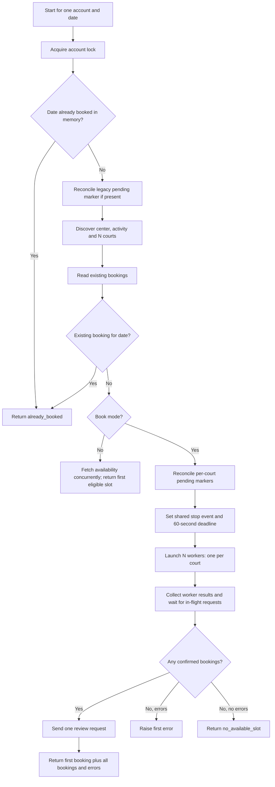
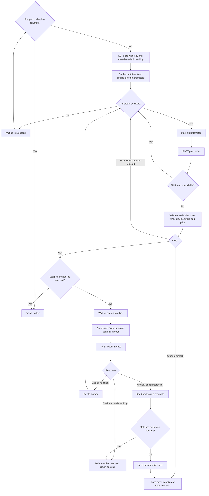

# Concurrent booking flow — current implementation

Reviewed 2026-10-29. This describes the code as it exists, including the limitations below. N is the number of distinct courts returned by the API whose names match `แบดมินตัน สนาม <number>`.

## Each court worker

## Review findings

Assumed load: one bot process for one account, with N court workers. Concurrent successes are accepted by design.

1. **Pending reconciliation can be skipped.** Existing bookings are checked before per-court markers. A confirmed booking returns early, leaving other uncertain requests unexamined. The marker loop also returns on its first confirmed marker. Reconcile all markers before any already-booked return; retain and report unresolved entries.
2. **A slot is excluded before any booking request.** `attempted` is updated before preconfirm. A slot that answers FULL and later becomes free is ignored for the remaining search period. Track sent booking requests separately; allow preconfirm-only rejections to be reconsidered after refresh.
3. **Transient preconfirm failure stops all courts.** Once its retries are exhausted, even a preconfirm HTTP 500 propagates to the coordinator and sets the shared stop event. Continue other courts and allow later refresh for transient read/preconfirm failures; stop globally for authentication, invalid data, or uncertain booking results.
4. **Stop and deadline checks occur before waiting for rate limits.** A worker can pass the check, wait, then submit a new booking after another court succeeds or the deadline expires. Check again after the wait and immediately before creating the marker and submitting the request.
5. **Review submission is reported without validating the response.** The new coordinator accepts any HTTP-success response as submitted, whereas the old path requires `status == "create success"`. Restore the response check.
6. **Concurrency acceptance tests are missing.** Current API tests use one court and a real 0.2-second deadline. Add deterministic multi-worker tests for actual overlap, stopping, multiple successes, pending recovery, FULL refresh, and the deadline. Avoid wall-clock assumptions in correctness tests.

Verdict: fix findings 1–5 and add concurrency regression tests before real booking.

Not checked: real API booking, server-side account limits, and rendered Mermaid output. Review only; application code was not changed during this review.
